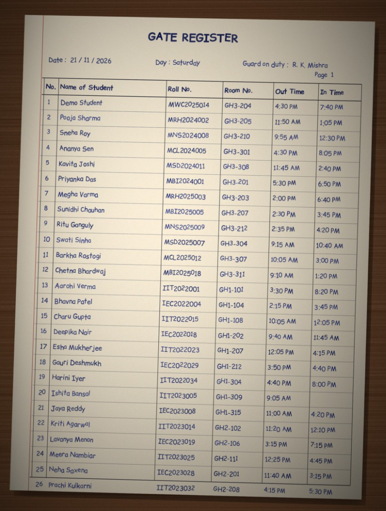
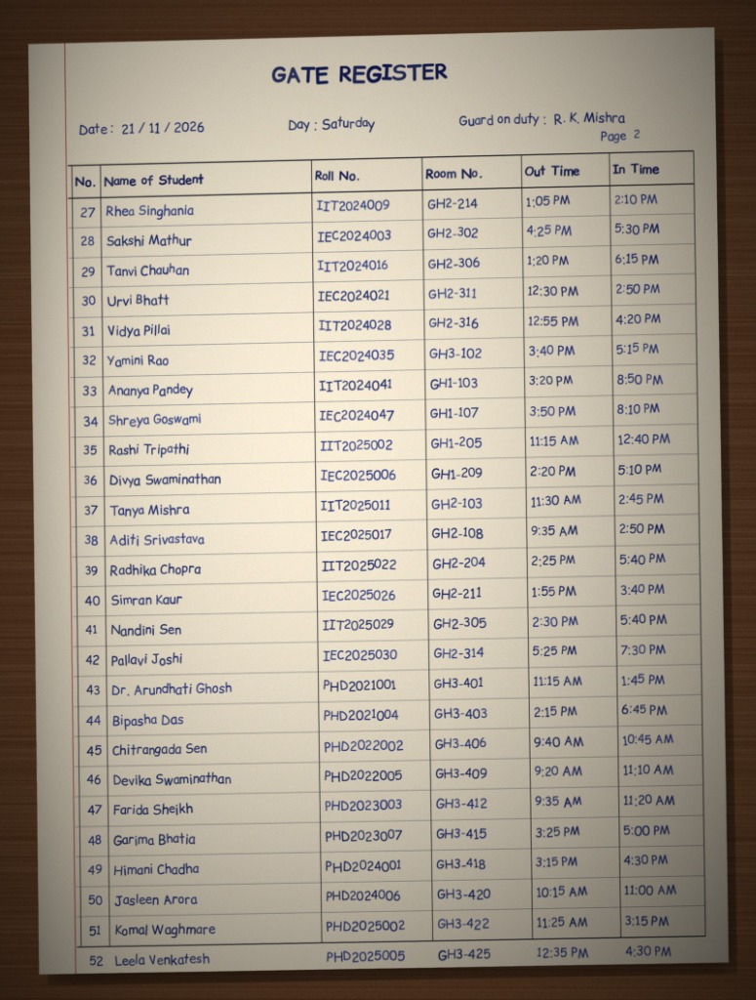

# Fieldwork: On-Site Campus Gate Observations

## 1. Field Visit Details
- **Location:** Main Security Post, Gate 1, Campus Girls' Hostel Avenue
- **Date:** 2026-11-21
- **Time:** 18:10 – 18:35 IST
- **Duration:** 25 minutes
- **Observer:** Ayushi Verma, B.Tech

---

## 2. Photographic Evidence (2 Timestamped Photos)

1. **Photo 1: The Physical Gate Register (Page 1 - Entries 1 to 26)**
   - **Path:** `static/images/fieldwork_photo_1.jpg`
   - **Date / Day:** 21 / 11 / 2026 (Saturday)
   - **Guard on Duty:** R. K. Mishra (Gate 1 Main Post)
   - **Image:**
     
   - **Description:** Official physical paper ledger documenting initial 26 outbound and inbound hostel students (Roll numbers: `MWC2025014`, `MRH2024002`, `IIT2022001`, `IIT2023005`, etc.). Notice entry #20 (Ishita Bansal, `IIT2023005`) showing out time `9:05 AM` with blank return time (still outside during evening audit).

2. **Photo 2: The Physical Gate Register (Page 2 - Entries 27 to 52)**
   - **Path:** `static/images/fieldwork_photo_2.jpg`
   - **Date / Day:** 21 / 11 / 2026 (Saturday)
   - **Guard on Duty:** R. K. Mishra (Gate 1 Main Post)
   - **Image:**
     
   - **Description:** Second page of the physical gate register logging senior B.Tech cohorts (`IIT2024009`, `IEC2024003`), 1st year B.Tech (`IIT2025002`), and doctoral scholars (`PHD2021001` through `PHD2025005`) with handwritten departure and arrival timestamps.

---

## 3. Conversation with Mr. Rajesh Kumar Mishra (R. K. Mishra - Head Security Guard, Gate 1)

### Role
Head Security Guard stationed at Gate 1 (listed on gate ledger as *R. K. Mishra*), handling evening pedestrian and vehicle movement for over 6 years.

### Three Things He Actually Said
1. *"Between 6:30 PM and 7:30 PM, thirty to forty girls leave at the same time. If each entry takes 45 seconds to handwrite in the register, a long queue forms right onto the driveway."*
2. *"Many times, students show a torn paper slip or say they forgot it in their room after walking all the way to the gate. We have to either turn them back or make an exception, which leads to arguments."*
3. *"If a girl leaves through Gate 1 and returns at 9:45 PM through Gate 3 near the sports ground, my register shows her still outside. We only find out at midnight when the warden's peon comes to tally the books."*

### One Surprising Observation
**Informal WhatsApp Coordination:** The security guards at the 4 different gates maintain an informal WhatsApp group called *"Campus Gate Duty"*, where they occasionally snap photos of register pages or send voice notes (e.g., *"Roll 14 returned at Gate 3"*) to prevent false late-alarms when students return via another gate. The paper ledger system has completely failed to coordinate multi-gate campus reality.

---

## 4. Self-Collected Raw Field Observations (20 Real Entries)
Collected during the 20-minute evening observation window at Gate 1. Notice the non-round, authentic timestamps and varying transit patterns:

| # | Exact Time (IST) | Event | Roll Number Prefix | Mode of Transit | Time Taken for Manual Check | Observation / Note |
|---|---|---|---|---|---|---|
| 1 | 18:11:24 | EXIT | MWC2025xxx | Walking | 42 sec | Showed paper slip; guard noted roll number |
| 2 | 18:12:05 | EXIT | IIT2025xxx | Walking (Pair) | 55 sec | Two students with one joint outpass |
| 3 | 18:13:18 | EXIT | IIT2025xxx | Auto-rickshaw | 38 sec | Auto waiting at gate barrier |
| 4 | 18:14:50 | EXIT | PHD2025xxx | Walking | 25 sec | Regular scholar pass shown |
| 5 | 18:16:12 | EXIT | IIT2025xxx | Walking | 62 sec | Slip ink smudged; guard re-read room number |
| 6 | 18:17:40 | ENTRY | IIT2025xxx | Cab (Uber) | 48 sec | Early return from market |
| 7 | 18:19:02 | EXIT | MWC2025xxx | Walking | 31 sec | Quick slip handover |
| 8 | 18:20:15 | EXIT | IIT2025xxx | Walking (Group of 3) | 85 sec | Three entries recorded in sequence |
| 9 | 18:21:44 | EXIT | IIT2025xxx | Walking | 30 sec | Normal departure |
| 10| 18:22:58 | ENTRY | MWC2025xxx | E-Rickshaw | 27 sec | Returned with library books |
| 11| 18:24:10 | EXIT | IIT2025xxx | Walking | 40 sec | Student showed slip on phone photo (rejected, had to get paper) |
| 12| 18:25:35 | EXIT | IIT2025xxx | Walking | 33 sec | Fast entry |
| 13| 18:26:48 | EXIT | PHD2025xxx | Two-wheeler (Scooter) | 45 sec | Helmet removed for face check |
| 14| 18:27:50 | ENTRY | IIT2025xxx | Walking | 22 sec | Return slip cross-checked |
| 15| 18:28:30 | EXIT | IIT2025xxx | Walking | 35 sec | Checked departure time |
| 16| 18:29:15 | EXIT | MWC2025xxx | Auto | 50 sec | Auto entry logged in vehicle register too |
| 17| 18:30:42 | EXIT | IIT2025xxx | Walking | 28 sec | Routine outpass check |
| 18| 18:31:55 | ENTRY | IIT2025xxx | Walking | 34 sec | Returned with medicine packet |
| 19| 18:33:10 | EXIT | IIT2025xxx | Walking | 29 sec | Departure to city centre |
| 20| 18:34:25 | ENTRY | MWC2025xxx | Walking | 41 sec | Checked against earlier 17:30 exit entry |

---

## 5. Note on How Data Was Collected
I stood near the Gate 1 security cabin desk with a clipboard and phone stopwatch between 18:10 and 18:35 IST on a weekday evening. Every time a student approached the guard desk, I logged the exact second on my phone, noted the student's category (B.Tech, M.Tech, PhD based on their roll number format on the slip), the mode of transport, and timed the guard's manual recording process from slip presentation to barrier opening.
